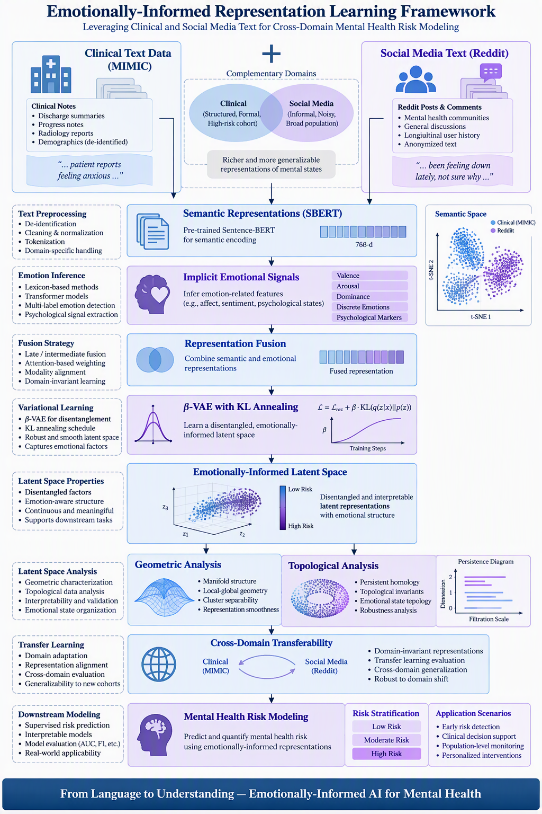
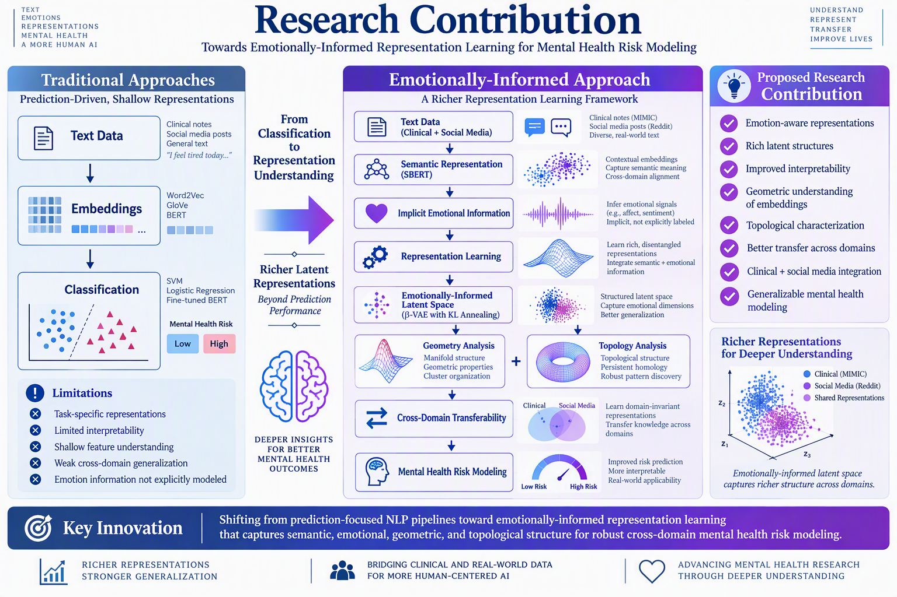
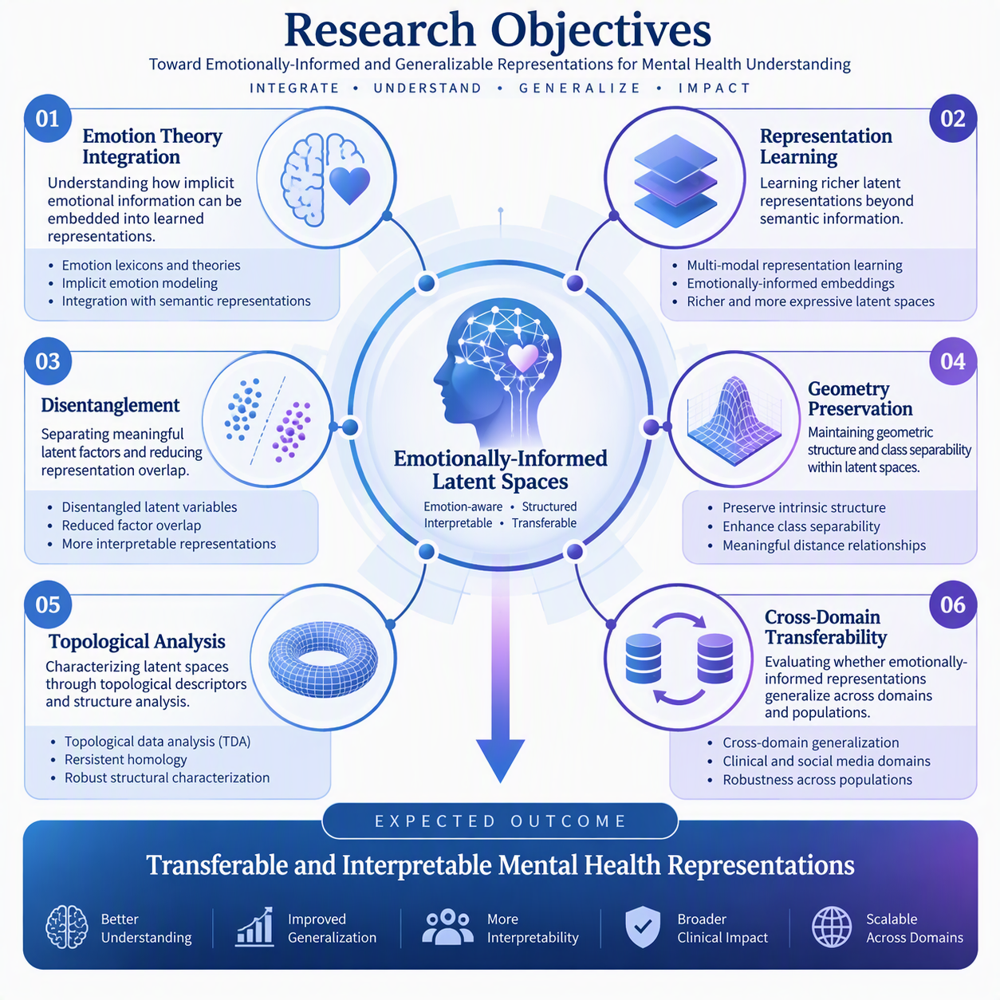
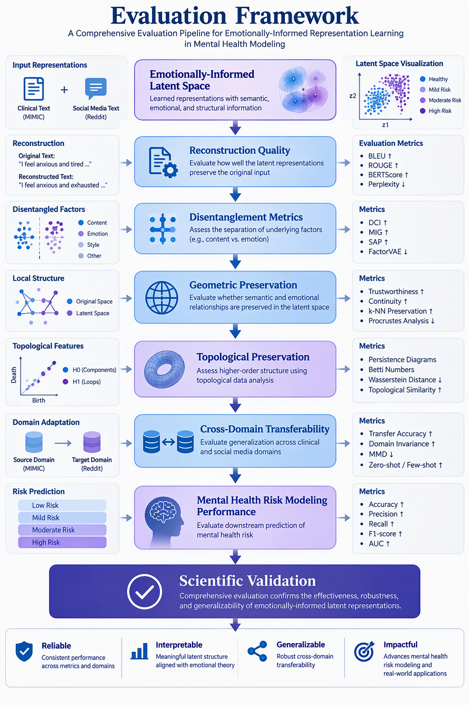

# Emotionally-Informed Representation Learning for Cross-Domain Mental Health Risk Modeling

Research framework exploring emotionally-informed latent representations for the transferable analysis of complex human phenomena through geometry, topology, transfer learning, and representation learning.

  

---

## Research Overview

Current approaches to mental health modeling primarily focus on semantic information present in text while often overlooking the emotional structure implicitly embedded within language.

This research investigates whether emotionally-informed latent spaces can provide richer, more transferable, and more interpretable representations than traditional semantic-only approaches.

Rather than treating emotions as an isolated classification target, the proposed framework integrates emotional information directly into representation learning, enabling the study of latent-space organization, transferability, geometry, and topology.

---

## Why This Research Matters

Human behavior emerges from complex interactions among emotions, cognition, context, and social dynamics.

Traditional machine-learning systems often focus on observable linguistic patterns while ignoring latent emotional structures that may influence behavior and mental health outcomes.

This research explores whether emotionally-informed representations can:

- Capture latent emotional information
- Improve representation quality
- Enhance interpretability
- Support cross-domain knowledge transfer
- Improve understanding of complex human phenomena
- Enable more robust mental health risk modeling

---

## Research Gap

Most current representation-learning approaches emphasize semantic information while emotional information remains either underrepresented or modeled separately through predefined labels.

Several important questions remain unanswered:

- How should emotional information be incorporated into learned representations?
- Can emotional information improve latent-space quality?
- Do emotionally-informed embeddings exhibit different geometric properties?
- How does emotional information affect latent topology?
- Can emotionally-informed representations improve transferability across domains?

---

## Scientific Contribution

  

Instead of treating emotion as a downstream prediction target, this research investigates emotion as a fundamental component of representation learning itself.

The proposed framework seeks to construct emotionally-informed latent spaces capable of preserving semantic information while simultaneously capturing meaningful emotional structure.

The objective is to determine whether emotional information contributes to more transferable, interpretable, and structurally meaningful representations.

---

## Research Objectives

  

### Primary Objective

Develop emotionally-informed latent representations capable of integrating semantic and emotional information while preserving meaningful structural properties.

### Specific Objectives

- Learn emotionally-informed latent representations
- Investigate semantic-emotional interaction within latent spaces
- Analyze geometric properties of learned embeddings
- Characterize topological properties of representations
- Improve cross-domain transferability
- Support mental-health risk modeling applications

---

## Methodological Foundations

### Emotional Information

Integration of implicit emotional signals into representation learning.

### Representation Learning

Construction of latent spaces capable of preserving semantic and emotional structure.

### Variational Learning

Learning compact latent representations through β-VAE architectures and latent regularization strategies.

### Geometric Analysis

Evaluation of latent geometry through distance preservation, clustering behavior, class separability, and manifold organization.

### Topological Analysis

Characterization of latent structures through topological descriptors and persistence-based approaches.

### Transfer Learning

Assessment of representational robustness across different domains, populations, and datasets.

---

## Research Methodology

The proposed methodology combines semantic representations, emotional information, latent-space learning, and structural analysis.

### Data Sources

- Clinical Mental Health Text
- Social Media Text
- Mental Health Related Corpora

### Representation Construction

- Sentence Embeddings
- Semantic Features
- Emotional Signals
- Representation Fusion

### Latent Space Learning

- β-Variational Autoencoders
- KL Annealing
- Latent Regularization

### Structural Evaluation

- Geometric Analysis
- Topological Analysis
- Representation Quality Assessment

### Cross-Domain Validation

- Transferability Analysis
- Generalization Assessment
- Domain Adaptation Evaluation

---

## Evaluation Framework

  

This research evaluates learned representations beyond predictive accuracy alone.

### Representation Quality

- Reconstruction quality
- Latent structure preservation
- Representation robustness

### Geometric Evaluation

- Distance preservation
- Cluster separability
- Manifold organization

### Topological Evaluation

- Persistent homology
- Structural characterization
- Topological consistency

### Transferability Evaluation

- Cross-domain adaptation
- Transfer learning performance
- Representation stability

### Downstream Evaluation

- Mental health risk modeling
- Behavioral analysis
- Decision-support applications

---

## Research Questions

This work investigates several fundamental questions:

1. Can emotional information be effectively incorporated into latent-space representations?

2. Which geometric properties emerge from emotionally-informed embeddings?

3. Can topological analysis reveal latent structures that are not observable through traditional approaches?

4. How transferable are emotionally-informed representations across different domains?

5. Can emotionally-informed latent spaces improve understanding of complex human phenomena?

---

## Expected Contributions

This research aims to contribute to:

- Emotionally-informed representation learning
- Human-centered artificial intelligence
- Geometric analysis of latent spaces
- Topological characterization of learned representations
- Cross-domain transfer learning
- Mental health analytics
- Explainable and interpretable AI systems

---

## Potential Applications

### Mental Health Analytics

Understanding behavioral and psychological patterns through representation learning.

### Human Behavior Modeling

Analyzing emotional and semantic interactions within language.

### Human-Centered AI

Building systems that incorporate richer representations of human information.

### Explainable Artificial Intelligence

Providing greater insight into latent structures and learned representations.

### Cross-Domain Knowledge Transfer

Improving model transferability across populations and domains.

### Decision Support Systems

Supporting data-driven decision-making using emotionally-informed representations.

---

## Current Status

This repository documents ongoing doctoral research focused on emotionally-informed latent representations for the analysis of complex human phenomena.

Current activities include:

- Literature review
- Methodological design
- sion

The long-term goal is to develop a general framework for emotionally-informed representation learning that contributes to:

- More transferable machine-learning models
- Better understanding of latent emotional structure
- Improved interpretability of learned representations
- Enhanced cross-domain generalization
- Richer analytical frameworks for complex human phenomena

---

## Research Implementation Summary

Due to data-use agreements, ethical considerations, and ongoing doctoral research activities, source datasets, training artifacts, experimental implementations, and trained models are not publicly distributed.

This repository focuses on documenting:

- Research motivation
- Scientific contribution
- Methodological framework
- Representation-learning strategy
- Latent-space analysis approach
- Evaluation methodology
- Expected research contributions

The objective of this repository is to communicate the conceptual, methodological, and scientific foundations of the research rather than provide a reproducible software package.

---

## Technologies and Research Areas

### Artificial Intelligence

- Deep Learning
- Representation Learning
- Variational Autoencoders (VAE)
- Transfer Learning

### Natural Language Processing

- Sentence Embeddings
- Semantic Representations
- Emotion Modeling

### Mathematical Analysis

- Geometric Deep Learning
- Topological Data Analysis
- Latent Space Analysis

### Mental Health Analytics

- Risk Modeling
- Behavioral Modeling
- Cross-Domain Learning

---

## Author

Marco Arciba

**Data Scientist | Forecasting & Advanced Analytics | AI & Business Intelligence**

*Turning Data into Business Decisions*

